# deli — a grocery theme for StoreOS

**deli** is a fresh, fast grocery storefront for [StoreOS](https://storeos.dev), built as a Fluid theme. It's designed for supermarkets and quick-commerce shops: a big search bar up front, category tiles, delivery promises, product cards with one-tap **Add to Bag**, and the whole shopper journey — sign-in, orders, bag, wishlist and order tracking — in the store's own design.

Primary color **#91C846**, Rubik type, one corner radius everywhere.

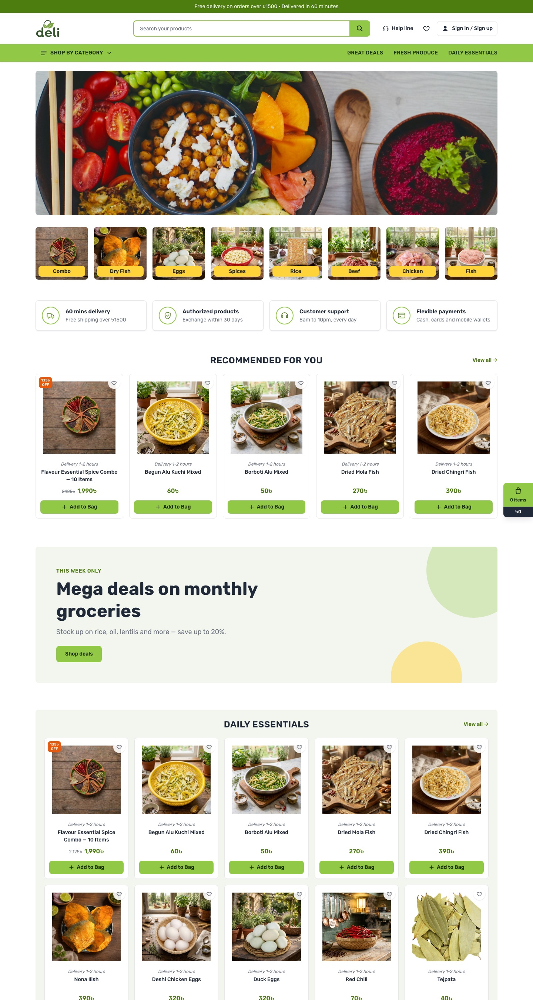

---

## Screenshots

### Desktop · 1440px

| Collection | Product |
| --- | --- |
| 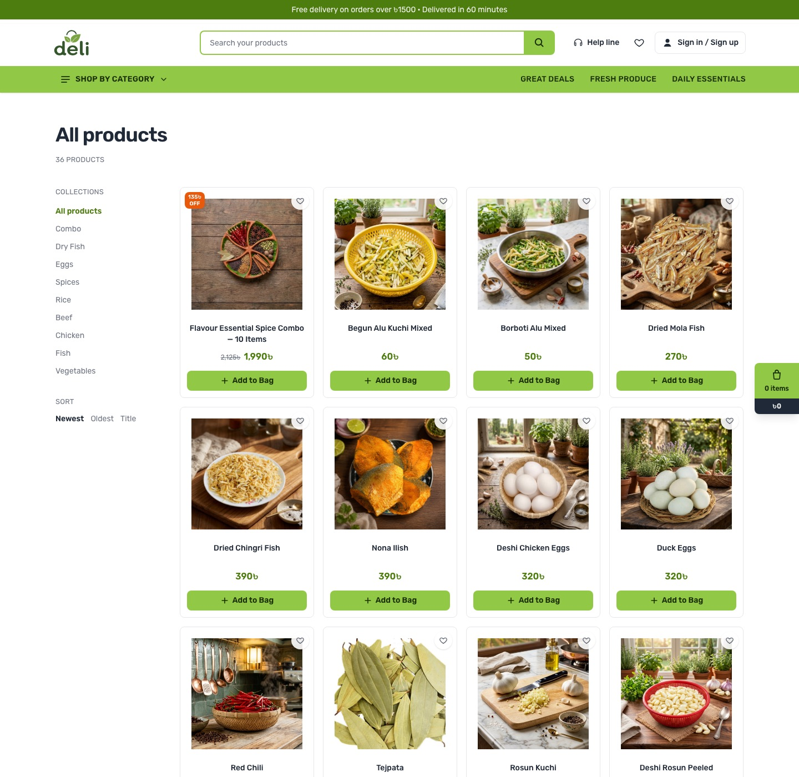 | 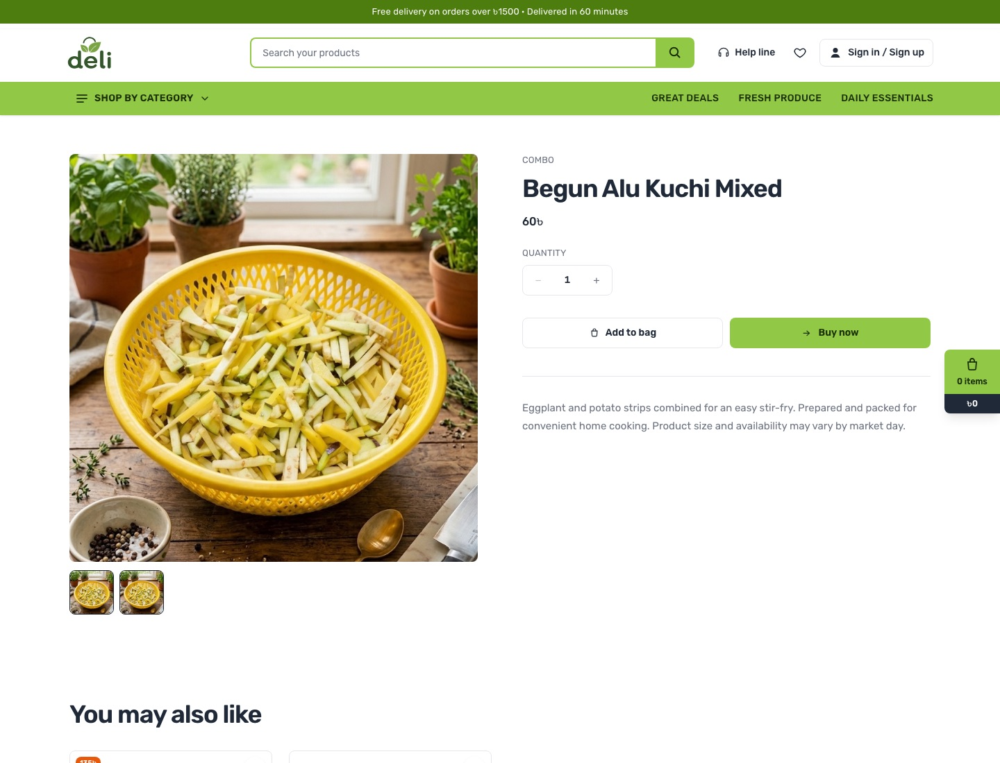 |
| **Sign in** | **Page not found** |
| 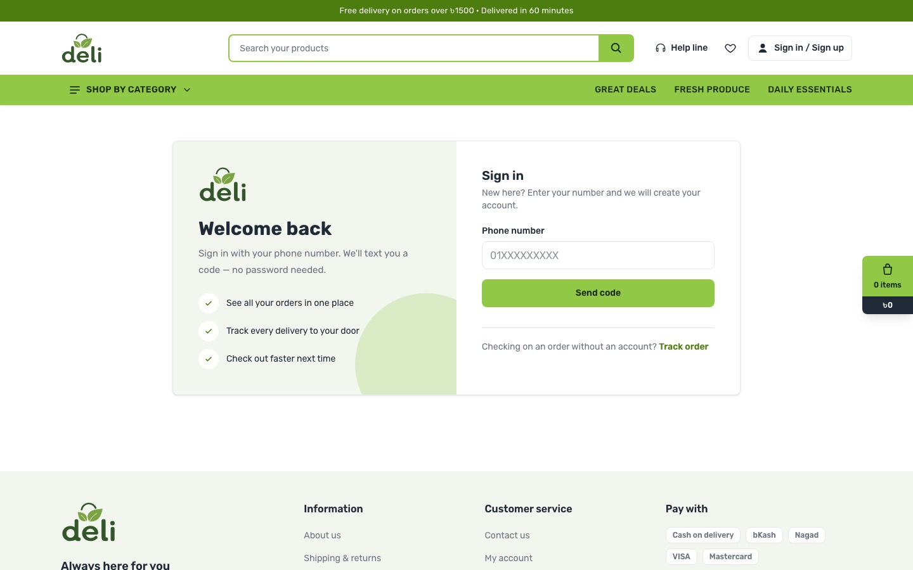 | 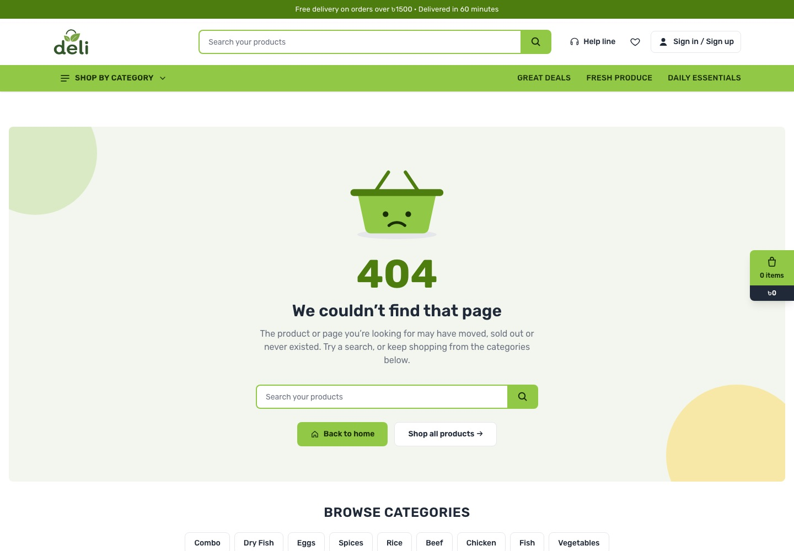 |

### Tablet · 768px

| Home | Collection |
| --- | --- |
| 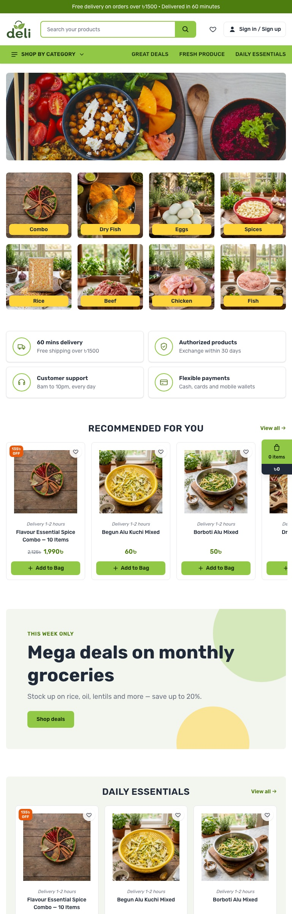 | 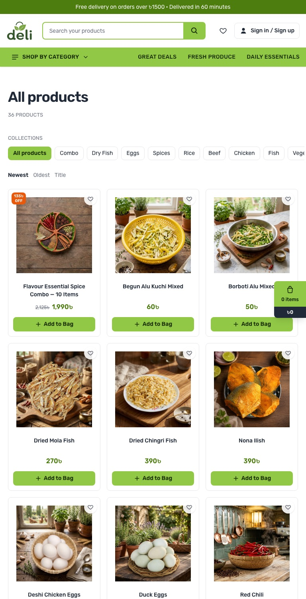 |

### Mobile · 390px

| Home | Product | Bag | Sign in |
| --- | --- | --- | --- |
| 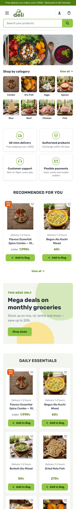 | 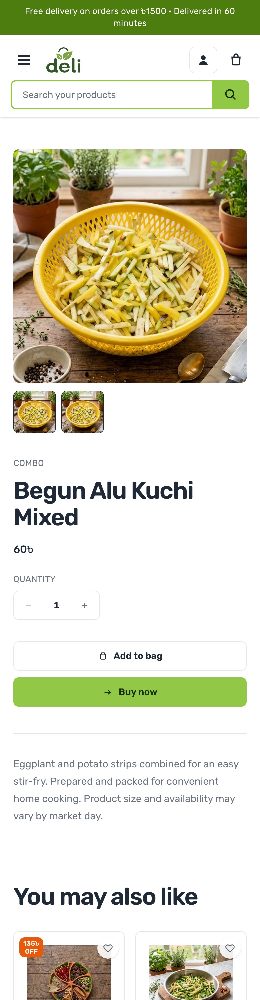 | 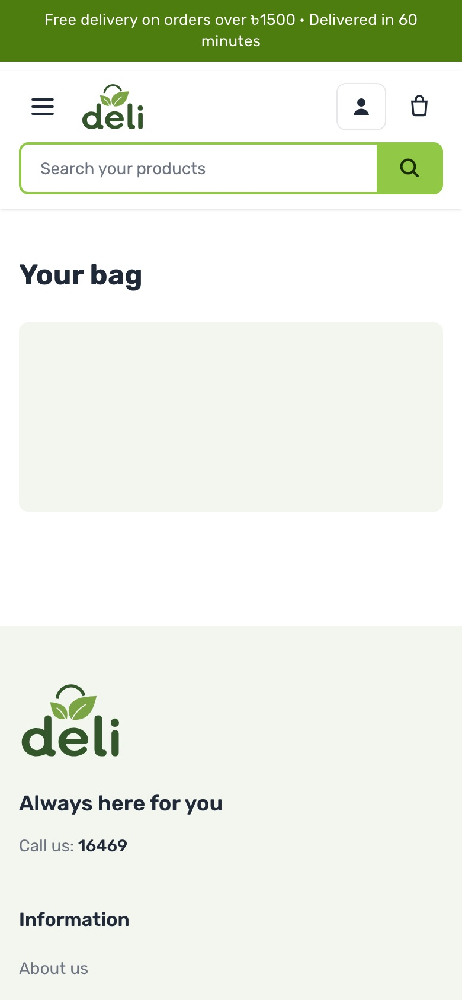 | 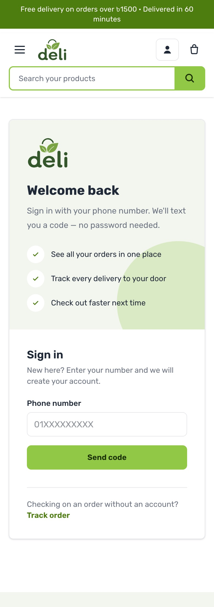 |

Screenshots use the `deli` demo store's catalog.

---

## Features

**Shopping**
- Two-tier header: logo, centered search with live product suggestions, help line, wishlist and sign-in on a white bar; a green category bar with a **Shop by category** menu below.
- Product cards with discount tags (“৳135 OFF”), a delivery note, a wishlist heart, and **Add to Bag** that turns into a − / + stepper.
- Floating side cart (item count and total) and a slide-out bag drawer.
- Hero slider, category tiles (a compact 4-column grid with names under the photos on phones, big labelled tiles on larger screens), trust strip, promo banner and product rows, all editable in the customizer.
- About, shipping and other CMS pages and the blog are styled too, including headings, lists, quotes and images merchants write.
- Responsive from 320px phones to wide desktops, with no sideways scrolling.

**Shopper pages** (the theme designs these instead of StoreOS's defaults)
- **Sign in** — phone number and a one-time code; first-time shoppers add their name.
- **Account** — greeting, order / wishlist / bag counts and recent orders.
- **Orders** — every order with status, items and total, with paging.
- **Profile** — edit your name.
- **Bag** (`/cart`) — change quantities, remove items, order summary and checkout.
- **Wishlist** — saved products, shared with StoreOS's own pages.
- **Track order** — a five-step delivery timeline, items, totals and address. Works without signing in.
- **404** — a friendly “we couldn't find that page” with search and category links.

Shoppers stay signed in, and keep their wishlist, when they move between deli's pages and StoreOS pages such as checkout.

**Brand**
- deli logo in the header and footer (switch to the store's own logo per widget), and a leaf-and-handle favicon that adapts to dark browser tabs.

---

## Pages and widgets

| Page | URL | Widgets in `config/document.json` |
| --- | --- | --- |
| Home | `/` | `hero-slider`, `category-tiles`, `feature-strip`, `featured-collection` ×2, `promo-banner` |
| Collection | `/collections/:handle` | `main-collection` |
| Product | `/products/:handle` | `main-product`, `product-grid` |
| Search | `/search?q=` | `main-search` |
| CMS page | `/pages/:slug` | `main-page` |
| Blog | `/blog` | `main-blog` |
| Blog post | `/blog/:handle` | `main-article` |
| Account | `/account` | `main-account` |
| Sign in | `/account/login` | `main-login` |
| Orders | `/account/orders` | `main-orders` |
| Profile | `/account/profile` | `main-profile` |
| Bag | `/cart` | `main-cart` |
| Wishlist | `/wishlist` | `main-wishlist` |
| Track order | `/track-order[/:id]` | `main-track-order` |
| Checkout | `/checkout` | `main-checkout` |
| Not found | any missing page | `layout/not-found.fluid` |

Every page has the `announcement-bar` and `header` at the top and the `footer` at the bottom.

`main-*` widgets are each page's core content: they read that page's data and only appear on that page in the customizer. The others are sections a merchant can add, remove and reorder anywhere.

---

## Theme settings

Colors live in `config/document.json` → `globalSetting.colors`, and merchants change them under **Theme Settings** in the customizer.

| Key | Default | Used for |
| --- | --- | --- |
| `primary` | `#91C846` | Buttons, the category bar, highlights |
| `onPrimary` | `#1A2E05` | Text and icons on the primary color |
| `accent` | `#4D7C0F` | Prices, links, the announcement bar |
| `highlight` | `#FFD43B` | Category tile labels |
| `sale` | `#E8590C` | Discount tags, the wishlist heart |
| `soft` | `#F3F6EE` | Soft panels, the footer |
| `text`, `muted`, `border`, `background`, `page` | — | Base colors |

Fonts default to **Rubik**. Corner rounding follows **Site Settings → Layout → radius** (8px by default), so one setting makes the whole shop sharper or softer.

---

## Development

Needs [Bun](https://bun.sh) and the StoreOS CLI.

```bash
bun install
bun run build        # Tailwind → assets/theme.css, src/ → assets/theme.js
```

```bash
storeos theme dev    # preview at http://localhost:9292 with live reload
```

```bash
storeos theme check  # validate, same checks as upload
```

```bash
storeos theme package  # writes deli.zip for Online store → Themes → Upload theme
```

While editing styles or scripts, run `bun run css:watch` and `bun run js:watch` alongside `theme dev`. The theme ships its own compiled `assets/theme.css`, so rebuild before packaging.

> **CLI version:** the shopper pages (`/account`, `/cart`, `/wishlist`, `/track-order`) and the 404 for unknown URLs need a StoreOS CLI and storefront that support them (StoreOS branch `feat/theme-shopper-pages`). With an older CLI those URLs show StoreOS's own pages.

### Project layout

```
deli/
├── layout/
│   ├── theme.fluid          page shell (header, page, footer, favicon)
│   └── not-found.fluid      404 page
├── widgets/                 one file per widget (markup + )
├── snippets/                product-card, search-box, order-card, account-nav, cart-drawer, price
├── config/document.json     starting pages, widgets and theme colors
├── locales/en.default.json  shopper-facing text
├── src/                     Alpine.js: cart, search suggestions, quick add, account pages
├── styles/input.css         Tailwind source
├── assets/                  built theme.css / theme.js, logo.svg, favicon.svg, screenshot.jpg
└── docs/screenshots/        README images (not part of the theme zip)
```

### How shopper pages load data

The server renders these pages the same for everyone. In the browser, `src/account.js` calls the Storefront API at `shop.api_url` (sign-in, orders, profile, order tracking). The sign-in token is kept in the `storeos__auth_<store>` cookie and the wishlist in `localStorage` under `storeos__wishlist_<store>` — the same keys StoreOS's own pages use. In `storeos theme dev`, `shop.api_url` is empty and the dev server forwards `/api/…` to your store.
